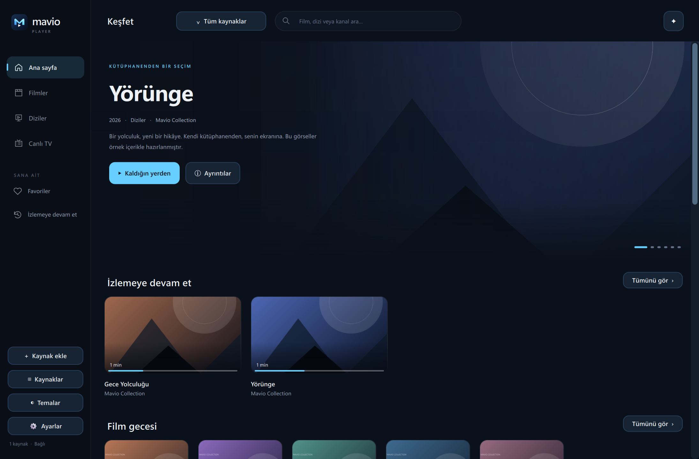
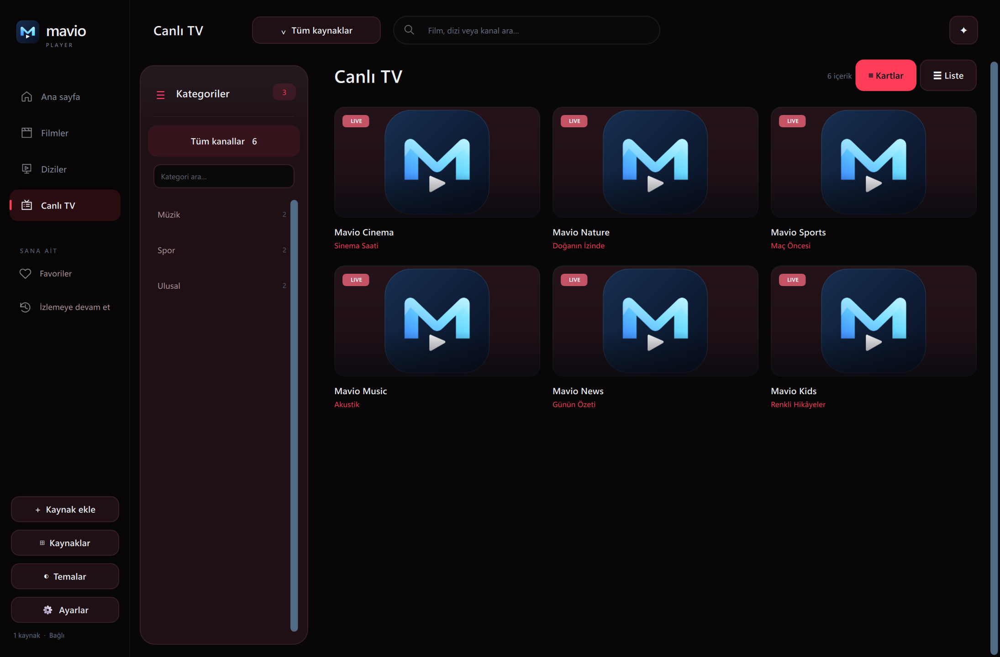
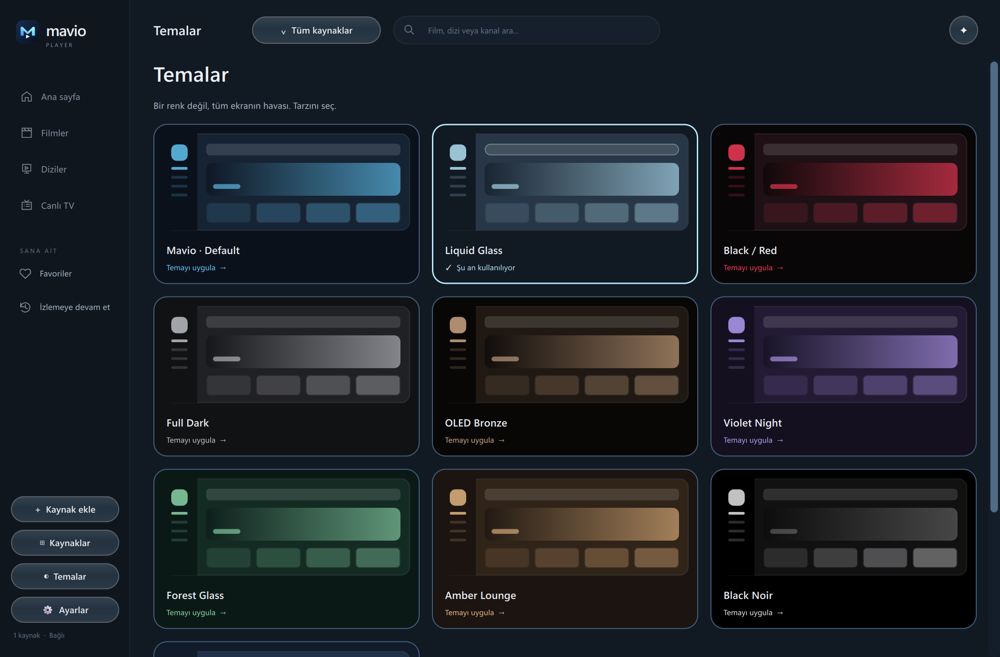
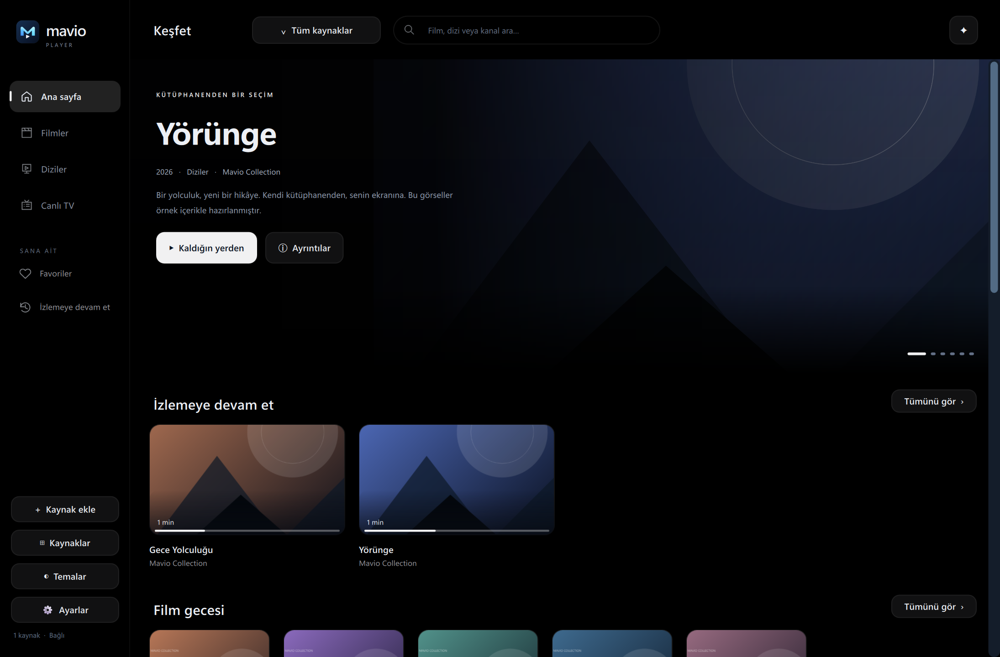

  
  <h1>Mavio Player</h1>
  
<strong>Senin ekranın. Senin dünyan. Your screen. Your world.</strong>

  
Film, dizi ve canlı TV için kişisel medya alanın. A personal home for your movies, series and live TV.

  

    
    
    
  

  
<strong><a href="https://github.com/Berkayrealx/mavio-player-releases/releases/latest/download/MavioPlayer-Windows-x64.zip">↓ Windows için indir · Download for Windows</a></strong>

## Türkçe

**Mavio Player**, kendi M3U/M3U8 listen veya Xtream hesabınla kullandığın Windows oynatıcısıdır. Film, dizi ve canlı yayınlarını tek bir kütüphanede düzenler. Bu depo **indirilebilir uygulama paketleri, kılavuzlar ve sürüm notları** içindir; Mavio'nun uygulama kaynak kodu burada yayınlanmaz.

### İlk kez mi kullanıyorsun?

1. [Windows paketini indir](https://github.com/Berkayrealx/mavio-player-releases/releases/latest/download/MavioPlayer-Windows-x64.zip).
2. ZIP'e sağ tıkla → **Tümünü Ayıkla**. `MavioPlayer` klasörünü istediğin kalıcı konuma taşı.
3. Klasördeki **MavioPlayer.exe** dosyasını aç. EXE'yi klasördeki diğer dosyalardan ayırma.
4. **Kaynak ekle** ile M3U bağlantını, M3U dosyanı veya Xtream bilgilerini gir.
5. İçeriğini **Filmler**, **Diziler** veya **Canlı TV** bölümünden aç.

**[Resimli ve ayrıntılı Türkçe kullanım kılavuzu →](docs/KULLANIM-TR.md)**

### İçeride neler var?

| Özellik | Nasıl kullanılır? |
| --- | --- |
| Ayrı kaynaklar | Üstteki kaynak menüsünden geçiş yap; farklı listelerin karışmasını önle. |
| Kaldığın yerden devam | Ana sayfadan devam et; istemediğin kaydı kartın kaldır düğmesiyle listeden çıkar. |
| Canlı TV + EPG | Kategori, arama, kart/liste görünümü; sağlayıcında varsa şimdi/sıradaki program. |
| Ses ve altyazılar | Oynatıcıdan ses/altyazı izi seç; altyazı görünümünü ayarla. |
| Dizi takibi | Sezon/bölüm seç, önceki/sonraki bölüme geç, diziyi takip et. |
| 10 tema | **Temalar** sayfasından Mavio Default, Liquid Glass, Black Noir, Black / Red, OLED Bronze ve diğerleri. |
| Güncellemeler | Açılışta ve 4 saatte bir kontrol; uygulama içinden onaylayarak indir ve yeniden başlat. |
| Türkçe / English | **Ayarlar** sayfasından dili değiştir. |

Mavio kanal, film veya abonelik sağlamaz. Kendi erişim yetkin olan kaynaklarını kullanırsın. EPG, ses izleri, altyazılar ve ileri sarma gibi olanaklar kaynağın sunduğu veriye bağlıdır. Intro/özet atlama, zaman aralığı tanımlanmış içeriklerde çalışır.

## English

**Mavio Player** is a Windows media player for your own M3U/M3U8 playlists and Xtream accounts. Organize movies, series and live TV in one library. This repository distributes **application packages, documentation and release notes**. Mavio's application source code is not published here.

### Get started

1. [Download the Windows package](https://github.com/Berkayrealx/mavio-player-releases/releases/latest/download/MavioPlayer-Windows-x64.zip).
2. Right-click the ZIP → **Extract All**. Move the `MavioPlayer` folder to a permanent location.
3. Open **MavioPlayer.exe** inside the folder. Keep its companion files together.
4. Choose **Add source**, then enter a playlist URL, select an M3U file or add your Xtream account.
5. Browse **Movies**, **Series** or **Live TV**.

**[Read the illustrated English user guide →](docs/USER-GUIDE-EN.md)**

Features include independent source switching, Continue Watching, favourites, season and episode selection, series tracking, EPG where available, audio/subtitle controls, picture aspect modes, 10 whole-app themes and updates with your approval. Choose **Settings** to change the app language.

Mavio does not provide channels, movies or subscriptions. Use sources you are authorized to access. Programme guides, subtitles, audio tracks and seeking depend on the source. Intro/recap skipping requires configured time ranges.

## Ekran görüntüleri · Screenshots

The screenshots below show the actual application with an original, synthetic demo library. They do not contain personal playlists, credentials or bundled streaming subscriptions.

| Canlı TV · Live TV | Temalar · Themes |
| --- | --- |
|  |  |

## Güncelleme ve veri · Updates and data

- **TR:** Güncellemeler otomatik kontrol edilir, onayın olmadan kurulmaz. İndirilen paketin imzası ve dosya özeti doğrulanır. Kaynakların ve izleme geçmişin `%LOCALAPPDATA%\MavioPlayer` altında kalır. Eski sürümlerde bu özellik yoktur; ilk kurulum için buradaki güncel paketi kullan.
- **EN:** Updates are checked automatically and installed with your approval. Package signatures and hashes are verified. Sources and watch history stay in `%LOCALAPPDATA%\MavioPlayer`. Older packages do not include the updater; start with the current download here.

## Destek · Support

[Sorun bildir · Report an issue](https://github.com/Berkayrealx/mavio-player-releases/issues/new?template=bug-report.yml) · [Sürüm notları · Release notes](https://github.com/Berkayrealx/mavio-player-releases/releases) · [Üçüncü taraf bileşenleri · Third-party components](THIRD_PARTY.md)

**Never post playlist URLs, passwords, Apple IDs or other account credentials in an issue. / Sorun bildirimlerine M3U bağlantısı, parola veya hesap bilgisi ekleme.**

Windows 10/11 x64. This download is for Windows PCs, not an iPhone IPA. Mavio's code and branding are reserved; third-party components retain their own licences. See [licence](LICENSE.txt).
