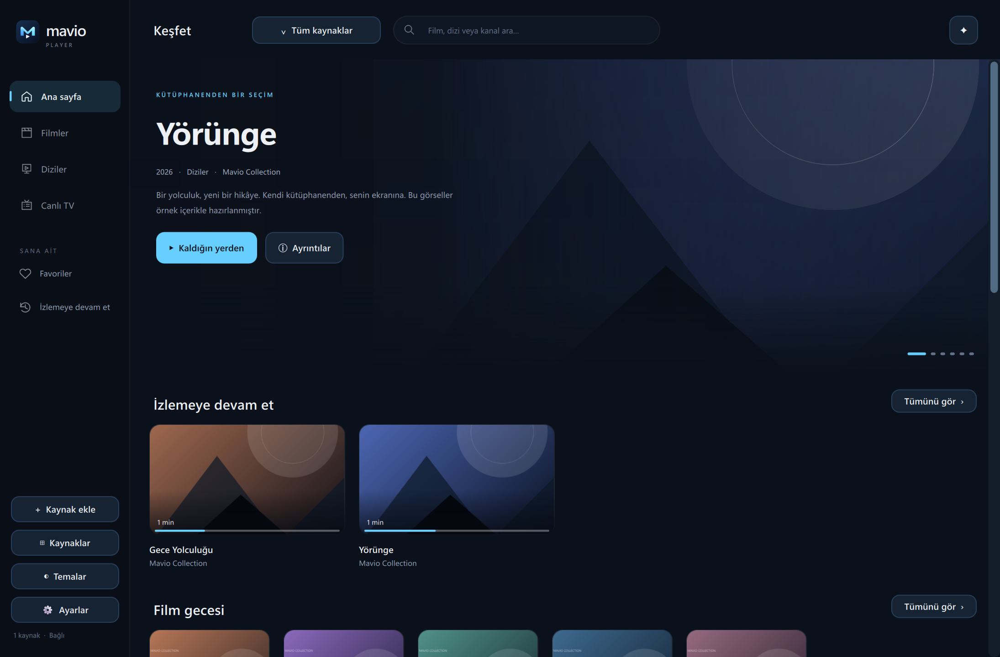
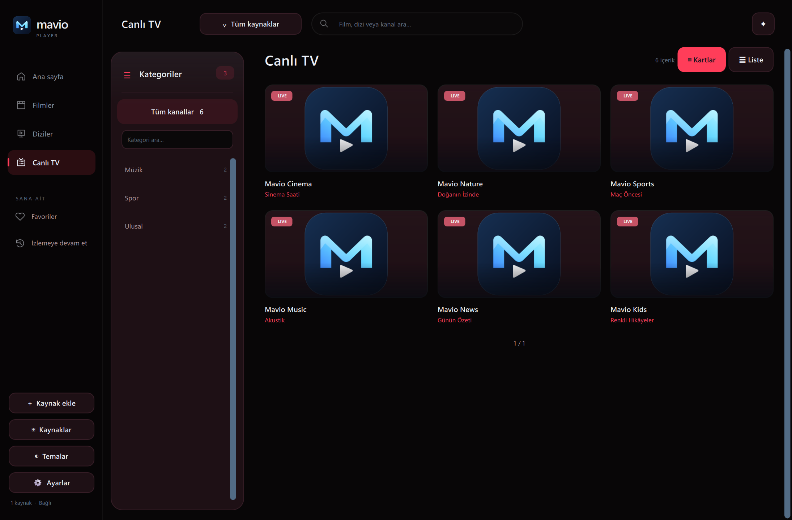
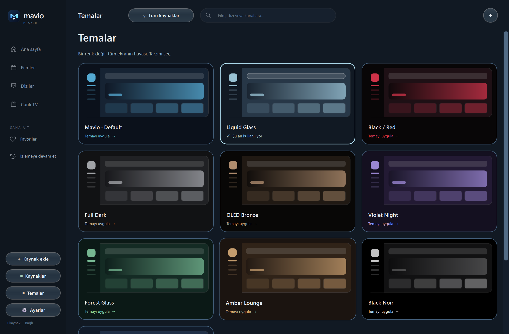

# Mavio Player — Türkçe kullanım kılavuzu

[← İndirme sayfası](../README.md) · [English](USER-GUIDE-EN.md)

## 1. İndir ve aç

1. [Son Windows sürümünü indir](https://github.com/Berkayrealx/mavio-player-releases/releases/latest/download/MavioPlayer-Windows-x64.zip).
2. ZIP'i tamamen ayıkla. Uygulamayı ZIP içinden çalıştırma.
3. `MavioPlayer` klasörünü örneğin Belgeler'e taşı ve içindeki `MavioPlayer.exe` dosyasını aç.
4. Masaüstü kısayolu istersen EXE'ye sağ tıkla → Gönder → Masaüstü (kısayol oluştur).

Python, VLC veya ayrı bir oynatıcı kurman gerekmez. Paket içindeki DLL ve klasörleri silme; yalnızca EXE'yi göndermek yeterli değildir. Windows 10/11, 64 bit gerekir. SmartScreen uyarısı çıkarsa kaynağın bu resmi indirme deposu olduğunu doğrula; antivirüsünü kapatma.

## 2. Kaynağını ekle

**Kaynak ekle** düğmesine bas. Sana verilen bağlantı türüne göre bir yol seç:

| Yöntem | Gireceğin bilgi |
| --- | --- |
| M3U bağlantısı | Sağlayıcının verdiği tam M3U/M3U8 URL'si. Bağlantıyı eksiltmeden yapıştır. |
| M3U dosyası | Bilgisayarındaki `.m3u` veya `.m3u8` dosyasını seç. Dosyanın içindeki yayınlar için internet gerekebilir. |
| Xtream | Sunucu adresi, kullanıcı adı ve parola. Kaynağa ayırt edici bir ad ver. |

Mavio kendi içeriğini sağlamaz. IPTV aboneliğin veya kullanma yetkin olan bir listen gerekir. Hesap bilgilerin indirme deposuna yüklenmez.

## 3. Kaynaklar arasında geç

Üst çubuktaki kaynak adına bas ve istediğin kaynağı seç. **Tüm kaynaklar** birleştirilmiş görünümü açar. Tek bir kaynak seçersen onun kataloğunu ve devam et kayıtlarını görürsün.

**Kaynaklar** sayfasında:

- **Bu kaynağa geç:** seçili kaynağı etkinleştirir.
- **Bağlantıyı göster:** URL'yi gösterir; kopyalayabilir veya metin dosyasına kaydedebilirsin. Bağlantı parola içerebilir, paylaşma.
- **Sil:** onayından sonra kaynağı, kayıtlı kataloğunu ve o kaynağın izleme geçmişini kaldırır. Önce bağlantıyı kaydetmek istersen bağlantı düğmesini kullan.
- **Şimdi yenile:** içerik ve yayın rehberini yeniden alır.

## 4. İzle, ara, kaldığın yerden devam et

**Filmler / Diziler / Canlı TV** bölümlerinden içerik türünü seç. Arama alanı başlık ve kategori bulmana yardım eder. Canlı kanala tıklayınca doğrudan oynar; dizi ayrıntılarında mevcut sezonu ve bölümü seçersin.

İzlemeye devam et bölümüne film ve bölümlerin konumu kaydedilir. Canlı yayın açıldığında güncel yayına bağlanılır; canlı TV'de geçmiş dakikaya dönüş ancak kaynağın bunu desteklemesiyle mümkündür. Kayıtlı kartın kaldır düğmesi yalnızca devam et kaydını temizler, sağlayıcındaki içeriği silmez.

Kalp düğmesiyle favorilere ekleyebilirsin. Dizi ayrıntılarındaki **Takip et** bölümleri takip eder; yeni bölüm bilgisi kaynağın yenilenmesiyle tespit edilir.

## 5. Oynatıcı kontrolleri

| Tuş / düğme | İşlev |
| --- | --- |
| Sağ / sol ok | Uygun film ve bölümlerde 10 saniye ileri / geri |
| Yukarı / aşağı ok | Sesi artır / azalt |
| Boşluk | Oynat / duraklat |
| F | Tam ekranı aç / kapat |
| Esc | Fare kilidi açıksa kilidi kaldırır; sonraki basış tam ekrandan çıkar |
| Önceki / sonraki bölüm | Bölüm sırasındaki komşu bölüme geçer |
| Dublaj / Ses | İçerikte bulunan ses izini seçer |
| Altyazılar | Altyazı izini ve görünüm ayarlarını açar |
| Görüntü / en-boy | Orijinal, 16:9, 4:3, sığdır, doldur/kırp, uzat seçenekleri |
| İstatistikler | Kaynağın bildirdiği FPS, çözünürlük ve bit hızı gibi bilgileri gösterir |

Altyazı fontu, boyutu ve saydamlığını ayarlayabilirsin. Her içerikte bütün dil izleri bulunmayabilir. Intro/özet atlama için içerik üzerinde tanımlı başlangıç-bitiş aralığı gerekir; otomatik olarak her diziyi tanıdığı anlamına gelmez.

## 6. Canlı TV ve EPG

Kategoriler sol tarafta, kanal araması üsttedir. Kart veya liste görünümünü seçebilirsin. Sağdaki kaydırma çubuğunu tutup sürükleyerek uzun listede hızlı hareket edebilirsin.

Program adı, saat ve sıradaki program, sağlayıcının EPG/XMLTV verisi varsa görüntülenir. **Program bilgisi yok** yazıyorsa kaynak eşleşmesi veya yayın rehberi bulunmuyor olabilir; görüntüden program tahmini yapılmaz. Ayarlardan açılışta yenilemeyi etkinleştirebilir, **Şimdi yenile** ile elle güncelleyebilirsin.

## 7. Temalar ve dil

Sol menüde **Temalar** ayrı bir sayfadır. Kartına tıkladığın tema uygulanır ve seçimin kaydedilir. Mavio Default, Liquid Glass, Black / Red, Full Dark, OLED Bronze, Violet Night, Forest Glass, Amber Lounge, Black Noir ve Arctic Blue bulunur. Renkler, arka planlar, kart yüzeyleri ve oynatıcı kontrol panelleri birlikte değişir. Liquid Glass, Windows arayüzünde cam etkisi veren bir Mavio temasıdır.

**Ayarlar** sayfasından Türkçe / English, azaltılmış animasyon, açılış yenilemesi, oynatma ve tam ekran fare kilidi seçeneklerini değiştirebilirsin.

## 8. Uygulamayı güncelle

1. Yeni sürüm yayınlandığında kütüphanede bildirim görünür. Kontrol açılışta ve dakikada bir yapılır.
2. **Güncellemeyi indir** düğmesine basıp onayla. İlerlemeyi uygulamada görebilirsin.
3. **Güncelle ve yeniden başlat** ile ikinci onayı ver. Uygulama kapanır, yeni paket uygulanır ve tekrar açılır.
4. Kaynaklar ve izleme geçmişi uygulama klasöründen ayrı tutulur. Kurulum sırasında dosya değiştirme hatası oluşursa önceki paket geri konur.

Elle kontrol: **Ayarlar → Uygulama güncellemeleri**. Eski, güncelleme özelliği olmayan paketler için ZIP'i buradan yeniden indirmen gerekir. Bilgisayarın kapalıyken anlık bildirim gelmez; Mavio açıkken kontrol yapılır.

## 9. Sorun yaşarsan

- **Açılmıyor:** ZIP'in tamamını ayıkladığını ve EXE'nin yanındaki dosyaların yerinde olduğunu kontrol et.
- **Yayın açılmıyor / ileri sarılmıyor:** başka bir içerikle dene; sağlayıcının eşzamanlı bağlantı sınırı veya ileri sarma desteği etkileyebilir.
- **Katalog eski:** doğru kaynağı seç, sonra Şimdi yenile'yi kullan.
- **EPG eksik:** rehber verisi kaynağa bağlıdır; başka kaynakta bulunması bu kaynakta da bulunduğunu göstermez.
- **Güncelleme indirilmiyor:** internetini ve uygulama klasörüne yazma iznini kontrol et; elle indirme bağlantısını kullanabilirsin.

[Sorun bildir](https://github.com/Berkayrealx/mavio-player-releases/issues/new?template=bug-report.yml). Mavio sürümünü, Windows sürümünü ve hatayı tetikleyen adımları yaz. Ekran görüntülerindeki hesap bilgilerini kapat. M3U URL'si veya parola paylaşma.
