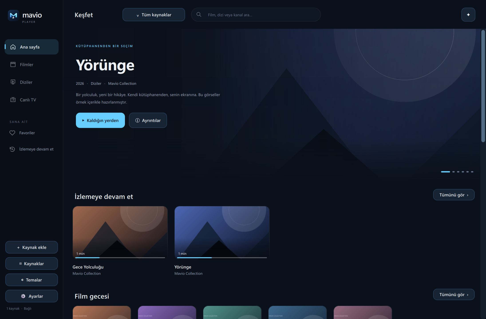
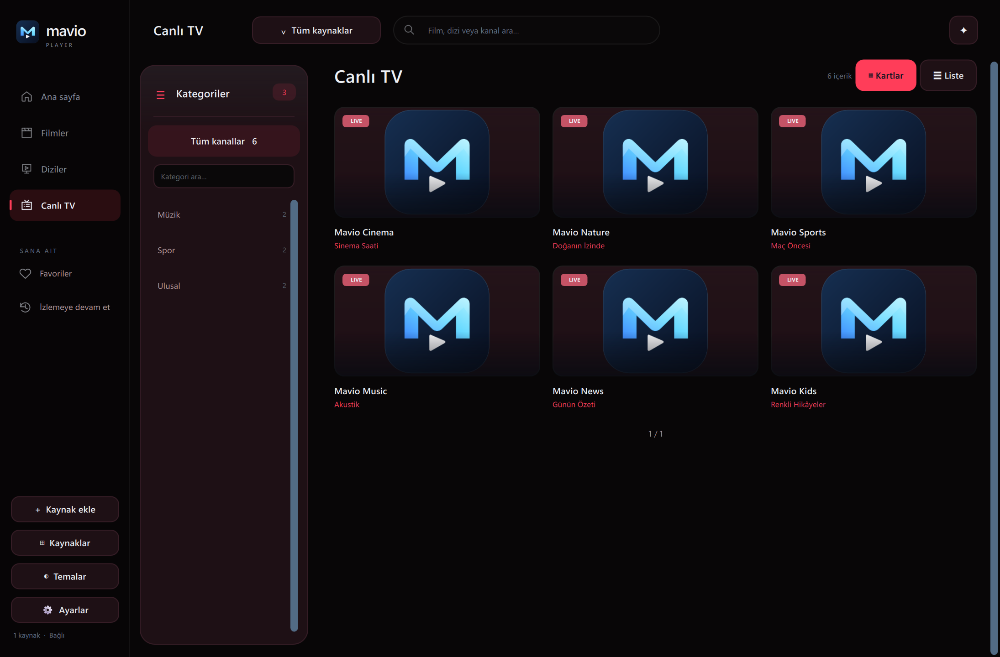
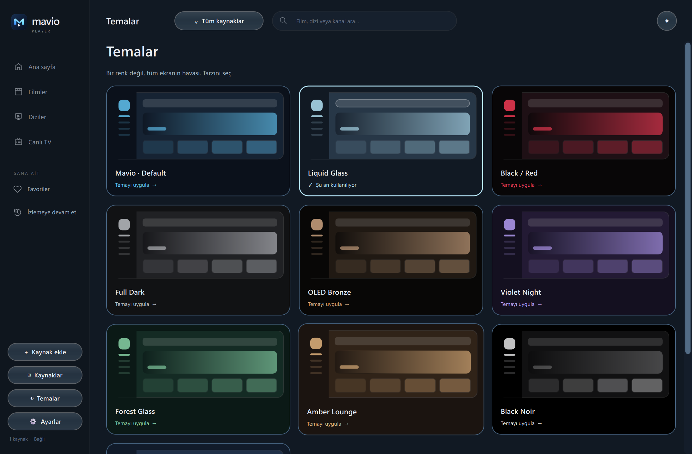

# Mavio Player — English user guide

[← Download page](../README.md) · [Türkçe](KULLANIM-TR.md)

## 1. Download and launch

1. [Download the latest Windows package](https://github.com/Berkayrealx/mavio-player-releases/releases/latest/download/MavioPlayer-Windows-x64.zip).
2. Right-click the ZIP and choose **Extract All**. Do not run it inside the ZIP.
3. Move the `MavioPlayer` folder to a permanent location and open **MavioPlayer.exe**.
4. To create a desktop shortcut, right-click the EXE and choose Send to → Desktop (create shortcut).

Windows 10/11 x64 is required. Python and VLC are not required. Keep all companion folders and DLLs with the EXE. If Windows shows a SmartScreen notice, verify that the package came from this official download repository; do not disable antivirus protection.

## 2. Add your source

Choose **Add source** and select the method matching your provider:

| Method | What to enter |
| --- | --- |
| M3U URL | Paste the complete M3U/M3U8 playlist URL without removing its parameters. |
| M3U file | Select a local `.m3u` or `.m3u8` file. Streams in the file may still need internet access. |
| Xtream | Server URL, username and password. Give the source a recognizable name. |

Mavio does not supply subscriptions or content. Use a source you are authorized to access. Account credentials are not uploaded to this download repository.

## 3. Switch and manage sources

Use the source menu in the top bar. **All sources** combines your catalogues; a specific source shows its own titles and Continue Watching entries.

On the **Sources** page:

- **Switch to this source** activates a source.
- **Show link** displays the URL, with copy and text-file export. A URL may contain a password, so keep it private.
- **Delete** asks for confirmation, then removes that source, its cached catalogue and its viewing history. Export the link first if you may want it again.
- **Refresh now** fetches current catalogue and programme-guide information.

## 4. Browse and continue watching

Browse **Movies**, **Series** or **Live TV**. Search titles and categories from the top bar. A live channel opens directly; series details let you choose available seasons and episodes.

Movie and episode progress is saved in **Continue Watching**. Live channels reconnect to the current broadcast; jumping back in live TV requires support from your source. The remove control on a Continue Watching card clears the saved entry; it does not delete the provider's title.

Use the heart button for favourites. **Follow** tracks a series; new-episode information is detected when its source is refreshed.

## 5. Player controls

| Shortcut / control | Action |
| --- | --- |
| Right / left arrow | Seek forward / backward 10 seconds when the source supports it |
| Up / down arrow | Increase / decrease volume |
| Space | Play / pause |
| F | Toggle fullscreen |
| Esc | Unlock the fullscreen mouse lock; press again to leave fullscreen |
| Previous / next episode | Go to the adjacent episode in the queue |
| Audio | Choose an available audio track |
| Subtitles | Select a subtitle track and adjust its appearance |
| Aspect ratio | Original, 16:9, 4:3, fit, fill/crop and stretch |
| Statistics | Display information reported by the stream, such as FPS, resolution and bitrate |

Subtitle font, size and opacity can be adjusted. Available languages depend on the media. Intro/recap skipping needs configured time ranges; it does not recognize every programme automatically.

## 6. Live TV and EPG

Find categories on the left and channel search at the top. Switch between cards and a list. Drag the right-hand scrollbar to move quickly through a large catalogue.

Programme titles, time ranges and next programmes appear when the source provides matching EPG/XMLTV data. **Programme info unavailable** means matching guide data is missing; Mavio does not infer programme names from the video. Enable startup refresh in Settings or choose **Refresh now** manually.

## 7. Themes and language

Open the dedicated **Themes** page in the sidebar. Click a preview to apply and save it. Options include Mavio Default, Liquid Glass, Black / Red, Full Dark, OLED Bronze, Violet Night, Forest Glass, Amber Lounge, Black Noir and Arctic Blue. Themes change backgrounds, cards, panels and player controls together. Liquid Glass is Mavio's glass-style theme for its Windows interface.

Use **Settings** for Turkish / English, reduced motion, startup refresh, playback preferences and the fullscreen mouse lock.

## 8. Update Mavio

1. Mavio checks for updates at launch and every minute while running.
2. When a newer version appears, choose **Download update** and confirm.
3. After downloading, choose **Update and restart**, then confirm the restart.
4. The app saves progress, closes, applies the package and reopens. Sources and watch history are stored separately from application files. A file-swap installation failure restores the previous package.

Manual check: **Settings → App updates**. Old packages without the updater need a manual download first. An offline or closed app cannot receive immediate notifications.

## 9. Troubleshooting

- **App will not open:** fully extract the ZIP and keep all companion files beside the EXE.
- **Stream or seeking fails:** try another title; provider connection limits or seeking support may affect playback.
- **Old catalogue:** select the correct source and refresh it.
- **Missing EPG:** guide coverage depends on the provider and channel matching.
- **Update fails:** check internet access and write permission to the application folder. You can download the package manually.

[Report an issue](https://github.com/Berkayrealx/mavio-player-releases/issues/new?template=bug-report.yml) with the app version, Windows version and steps to reproduce. Redact screenshots. Never include playlist URLs or passwords.
